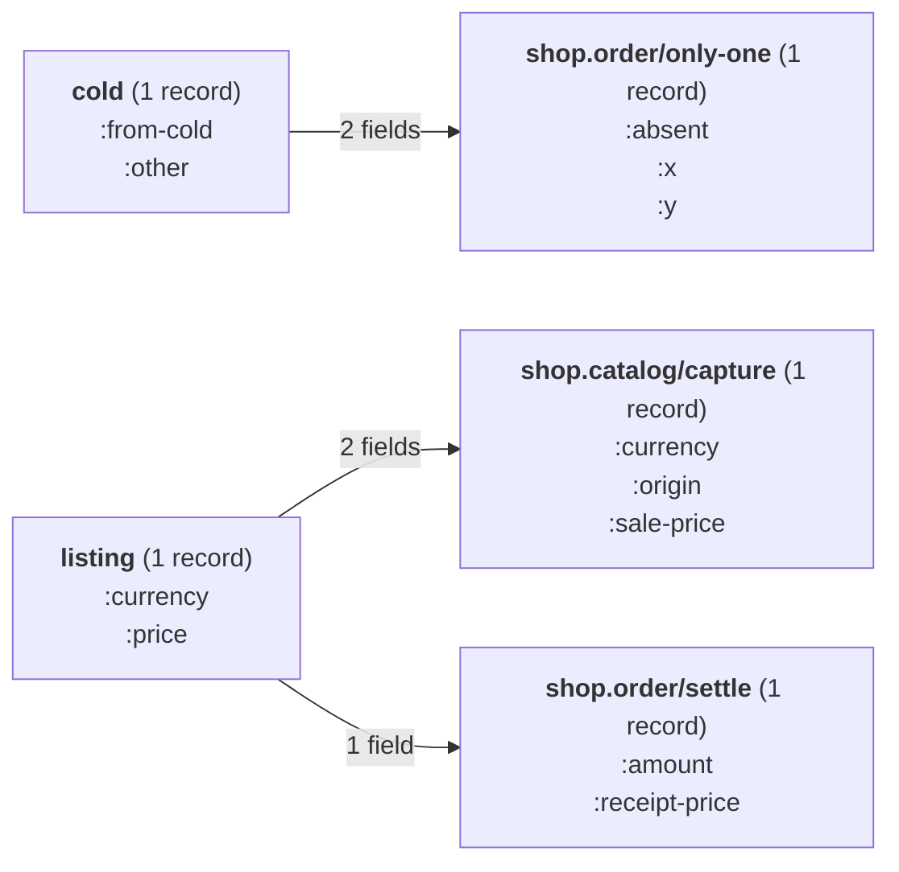

# layout-descent

Measured search for the data layout of nested-map access patterns in Clojure code.

You state a task in a plan file: the levels of a nested map, the type of its leaves, the access
patterns the code runs, and how often. layout-descent compiles the plan to a Clojure namespace
with one specialized function for each pattern, proves that namespace against a reference model,
times it, and tells you whether another plan is better. A program or a language model drives it
through a command line that answers in JSON, or through the Vis extension in
`.vis/extensions/`.

It is a search, not gradient descent: the moves are discrete (add an order, change a format,
move a pattern), and a move is kept only when a measurement says so.

## Requirements

- Clojure CLI 1.12 and a JDK (developed on Java 25).
- Python 3.10 or later, only for the Vis extension and its test.

## Quick start

```sh
cd layout-descent
clojure -M:cli help
clojure -M:cli facts ../some-project/src       # what the code does to nested maps
clojure -M:cli flow ../some-project/src --operation app.core/handle   # what one operation reads
cp examples/risk/plan.edn /tmp/plan.edn
clojure -M:cli verify /tmp/plan.edn            # gate: compile and compare with the model
clojure -M:cli descend /tmp/plan.edn           # greedy search, writes a candidate
clojure -M:cli accept /tmp/candidates/<task-hash>/<layout-hash>.edn --into /tmp/plan.edn
clojure -M:cli status /tmp/plan.edn
```

One run of the example on the development machine, weighted mean ns for each call. The cost of a
plan is the one that the next step measured for it. The gain is that of the step, measured again
on its own:

| Plan | Orders | Cost | Bytes | Step |
| --- | --- | --- | --- | --- |
| `e471a80f71f4` | `[0 1 2] :hash` | 6902 | 2,174,944 | start |
| `2de6f2cb6d30` | `[0 1 2] :hash`, `[2 1 0] :csf` | 210 | 2,690,688 | `descend`, -96.9 % |
| `34b4572423c3` | `[0 1 2] :hash`, `[2 1 0] :csf`, `[0 1 2] :csf` | 168 | 3,153,168 | `descend`, split, -19.4 % |

A candidate may be any valid plan of the task; `neighbors` and `descend` are only the mechanical
baseline. `neighbors` changes one decision at a time. `descend` adds one kind of candidate that
needs measurements: when a neighbor is faster on one pattern and slower on another, a `split`
keeps the orders of both plans and serves each pattern from the faster one. That is how
`[0 1 2] :hash` can stand beside `[0 1 2] :csf`, the point lookup and the scan each with its format.
A step is kept only when it is better alone.

A split adds an order, so it adds bytes. With `:ns-per-byte 0.0` those bytes are free and
`descend` takes a split for a small gain in time; its answer then carries the warning
`memory-not-priced` of the final plan. Set a price when memory counts. In the run above, the
neighbor `de8f7733f6b2` (`[0 1 2] :csf`, `[2 1 0] :csf`) was also better in the last step, with
978,224 bytes and a gain of 17.2 % against 20.8 % for the split. A step takes the better candidate
with the largest gain against the plan of its own batch.

Only the first step is the same in every run. Four runs of this example ended in four plans, each
97.4 % to 97.7 % below the start, because the candidates after the first step are close:

- **The second order.** `[2 0 1] :csf` and `[2 1 0] :csf` tie at -96.9 % to -97.0 %. Two runs took
  each.
- **The format of `[0 1 2]`.** The change to `:csf` gained 16.6 % to 17.9 % in every run. Three
  runs took it, and one took the split, as above.
- **`[0 1 2] :hash` as a third order** beside two `:csf` orders is worth 5 % to 7 %, with
  `:min-gain` at 5 %, for 3.2 to 3.4 times the memory. Two runs ended with it and two without.

A greedy search takes one of such candidates and does not say that the others are worse. Time them
together with `measure` before you choose between them.

`reach` in the answer of `descend` counts the candidates that were timed and lists what the search
does not try:

- **Two moves at once**, other than a split: an order added together with a format change of
  another order, or two patterns moved to another order together.
- **An added order that fixes no longer prefix**, such as a permutation that ties on the bound
  prefix but stores the scanned levels in another order.
- **The plans behind a better candidate** that did not have the largest gain of its step.

Write such a plan by hand and give it to `evaluate`. Expect `no-change` often.

## The plan file

A plan is one EDN map. `examples/risk/plan.edn` is a complete one.

| Key | Meaning |
| --- | --- |
| `:layout/version` | `1` |
| `:name` | A lower-case symbol |
| `:levels` | One to four `{:id :type}`; the type is `:keyword`, `:long` or `:string` |
| `:leaf` | `{:type t}`; `t` is `:double`, `:long` or `:object` |
| `:patterns` | `{:id :bind [...] :fold f}`; `:bind` has `:key` or `:scan` for each level; `:fold` is `:sum`, `:count` or absent |
| `:orders` | `{:perm [...] :format f}`; `:perm` is the order in which the levels are stored; `f` is `:hash` or `:csf` |
| `:serve` | Pattern id to order index. Optional: the default is the order with the longest bound prefix |
| `:workload` | `:fanout` and `:fill` for each level, `:seed`, and `:weights` for each pattern. Optional `:degree`, for each level `nil` or the exact number of keys under every parent, in place of `:fill` at that level |
| `:objective` | `:min-gain` (default `0.05`) and `:ns-per-byte` (default `0.0`), the price of memory |
| `:emit` | `{:ns some.ns :path "src/some/ns.clj"}`; the path is relative to the plan file |
| `:notes` | A string or a vector of strings: where the task comes from. `accept` keeps it; it drops EDN comments |

The **task** is `:levels`, `:leaf`, `:patterns` and `:workload`. The **layout decisions** are
`:orders` and `:serve`. A candidate keeps the task and changes the decisions. The plan hash covers
the decisions, the task hash the task. A pattern may carry other keys, such as `:doc` or `:sites`;
they and `:notes` change no hash.

`:fill [1.0 0.05]` gives every row about 5 % of the columns, a different number in each row.
`:degree [nil 12]` gives every row exactly 12, drawn by the seed: use it when the real data is
regular. A level with a degree ignores its `:fill`, and the degree is part of the task. It is
exact for each parent only: the columns of that example still hold different numbers of rows.

`check` warns with `memory-not-priced` when a plan has two or more orders and `:ns-per-byte` is
zero: an extra order then costs nothing, so a search will always add one. `partial-index` marks a
pattern whose order cannot reach all its bound levels.

Formats:

- `:hash`: nested `java.util.HashMap`. The fastest point lookup; scans follow pointers.
- `:csf`: sorted arrays for each level, with the leaves in one primitive array. A count of a
  subtree is a pointer difference, a sum of a subtree is one loop over a contiguous span, and the
  memory is a fraction of `:hash`.

Each pattern becomes one function, named by its id:

| Pattern | Call | Result |
| --- | --- | --- |
| all `:key` | `(value ds tenant entity feature)` | The leaf, or `nil` |
| some `:scan`, no `:fold` | `(entity-features ds f init tenant entity)` | A reduction; `f` gets `acc`, the scanned keys, the leaf |
| `:fold :sum` | `(feature-total ds feature)` | The sum of the leaves |
| `:fold :count` | `(tenant-size ds tenant)` | The number of leaves |

`(build nested-map)` in the same namespace makes `ds`. `status` prints the exact call of every
pattern. Key types are checked at `build`: a `:long` level takes integers in the signed 64-bit range.
An Integer key finds a Long key; `nil`, fractional and out-of-range query keys miss.
Scan order is unspecified. Use a reducer whose result does not depend on visitation order.
Returning `(reduced value)` stops the scan and returns `value`.

## Commands

Every command prints one JSON document on stdout, with snake_case keys and `"ok"`. Nothing else
goes to stdout.

| Command | Writes | Purpose |
| --- | --- | --- |
| `facts <src-dir>... [--limit N] [--min-depth N] [--writes true\|false]` | nothing | Path shapes of `get-in`, `get`, `reduce-kv` and others, with sites |
| `flow <src-dir> --operation <namespace/function> [--lang clj\|cljs]` | nothing | Named fields an operation produces, carries or uses; source sites and unresolved boundaries |
| `schema <src-dir> [--lang clj\|cljs] [--limit N] [--entity <id>\|loose] [--sites N] [--diagram <file.md\|file.mmd>]` | the file of `--diagram` | The data model of a code base: entities, the fields that one carries into another, and where the traces stopped |
| `check <plan>` | nothing | Validate; hash, task, warnings or problems |
| `status <plan>` | nothing | Workload, orders, patterns, calls, emitted file state and the cause when it is stale, last journal records |
| `report <plan>` | nothing | The fields of `status`, the plan text, the emitted source, every journal record and the kept candidates in one answer |
| `journal <plan> [--last N]` | nothing | Every journal record as JSON; `unreadable_lines` counts lines that are no record |
| `measure <plan>...` | nothing | Time plans of one task in one run: cost, bytes, ns of each pattern. No verdict |
| `verify <plan> [--source <trusted-clojure-file>]` | nothing for generated code | The gate; `--source` executes the supplied file |
| `neighbors <plan> [--out-dir <dir>]` | candidate files | Every plan one decision away |
| `evaluate <candidate> --against <plan>` | journal | Gate both, time both, verdict, sensitivity to the weights |
| `descend <plan> [--max-steps N] [--out <file>]` | the chosen plan of each step under `candidates/` beside the plan, journal | Greedy search over neighbors and splits; every step has cost, bytes and ns of each pattern; `reach` says how far it looked |
| `accept <candidate> --into <plan> [--force <reason>]` | plan, emitted file, journal | Take the candidate's decisions |
| `emit <plan> [--out <file>]` | optional preview file | Gate and preview the namespace; only `accept` writes the configured output |

Every command takes `--save <file>`: the file gets the same JSON document, and the answer names
it in `saved`. Only an answer with exit code 0 is saved; a refusal or a failure leaves the file as
it was. These files are refused: a plan, its journal and its emitted file, a source file below a
directory that the command reads, and any file below `candidates/` beside a plan or below
`--out-dir`.

Exit code 0: done. Exit code 1: refused or failed; `error.code` names the cause and `error.hint`
the next step. Exit code 2: wrong usage or an internal error.

## What keeps the search honest

- **The gate.** `layout-descent.model` answers every pattern from the plain nested map. Emitted
  code passes only when it compiles with no reflection or boxed-math warning and agrees with the
  model on five datasets (empty, one entry, empty inner maps, sparse, dense), with keys that hit,
  keys that miss and Integer keys. `evaluate`, `emit` and `accept` run it first.
- **One task.** Costs compare only between plans with the same task hash. `accept` refuses a
  candidate of another task, with or without `--force`.
- **Same data, interleaved rounds.** All plans of a measurement are built from one seeded
  dataset, called with the same arguments, and timed in turn. A measurement compiles the plans
  three times and shares the rounds among these generations; each generation warms another plan
  first. The time of a pattern is the lowest median of a generation, and its spread is the median
  distance of a sample from that time. The cost is the weighted time for each call, plus
  `:ns-per-byte` times the estimated bytes. Both costs use the baseline’s objective. Searches time candidates in bounded groups, each against its own baseline run.
- **A verdict needs a clear difference.** `better` and `worse` need at least `:min-gain` and more
  than three times the summed spread of the samples. Everything else is `no-change`, which says
  nothing about direction: the sign of `gain` is then noise.
- **Weights are a guess until measured.** `sensitivity` in an `evaluate` or `descend` answer
  compares each pattern on its own: `net_ns` is the time that the pattern gains plus the memory
  charge. `depends_on_weights` is true when the candidate wins on one pattern and loses on another
  beyond their noise; `flip_factor` is the multiple of one weight that reverses the sign of the
  difference. A factor of 2 means the verdict rests on the weights; 5000 means it does not.
- **Holdout.** A `better` verdict is measured again on data of another seed, and stays `better`
  only when that agrees. `descend` measures its chosen neighbor again on its own, which removes
  the luck of picking the minimum of several noisy numbers.
- **One writer.** Only `accept` writes an accepted plan and its emitted file. It needs a `better`
  verdict from the latest evaluation of those two hashes under the current objective in
  `<plan>.journal`, or `--force` with a reason, which the journal keeps. Older journal entries
  without an objective must be remeasured. It moves only `:orders` and `:serve`. Running it again
  changes nothing unless the emitted file is missing or stale. If publication is interrupted, fix
  the reported write problem and rerun `accept`; it finishes the recorded change before starting
  another. Do not remove the per-plan lock file while a command is running.

## Facts

`facts` uses clj-kondo to find the calls that resolve to the `clojure.core` map functions and
edamame to read their arguments. In a shape, `?` is a key that the code computes, `*` a scan and
anything else a constant:

```text
[":scores" "?" "?" ":risk"]   2 reads, 2 writes   -> two :key levels under a constant
[":scores" "?" "*"]           1 scan              -> a pattern [:key :scan]
```

Nested accesses are joined: `(get (get-in db [:scores t]) e)` is one site at `[:scores ?t ?e]`.
A lookup on the value inside the function of a scan continues the scan:
`(reduce-kv (fn [acc _ row] (+ acc (get row col 0))) 0 rows)` is one site at `[* ?col]`, a pattern
`[:scan :key]`. A function handed to `swap!` is a write to the reference. A path that is not a
literal vector is counted as `dynamic`.

A key that is a vector literal, as in `(get-in state [:world [x y]])`, is one map level with a
composite key. Its shape element is `"[? ?]"`, and each computed part counts as a level, because a
plan models each part as a level of its own.

The answer shows the shapes that can be a layout task. `hidden` counts the rest: shapes with fewer
than `--min-depth` (default 2) computed levels, such as a lookup in a set, and the sites that
write, which build the map and are no pattern. `--min-depth 1` and `--writes true` show them.
`--limit 0` gives the counts with no sites. File names are relative to `root`. When every shape is
hidden, `hint` names the two options.

`sources` counts the files by extension. With ClojureScript files the answer has the warning
`clojurescript-sources`: plans are measured and emitted for the JVM, so the timings do not transfer
to a JavaScript runtime and the emitted namespace does not load there. Facts decide nothing: you,
or the model, write the plan from them.

## Follow information through an operation

`flow` starts at one function, scans the source directory for definitions, and follows resolved calls
outward, including calls through namespace aliases. It does not load the application. For example:

```sh
clojure -M:cli flow test/fixtures/flow --operation shop.order/settle
clojure -M:cli flow test/fixtures/flow --operation board.game/act   # original .cljs sources
clojure -M:cli flow src --operation layout-descent.bench/center --save /tmp/center.json
```

- **Follow an operation:** `steps` are graph nodes with an `id`, `kind`, `via`, enclosing function
  (`in`), relative `file`, `row` and `col`. `inputs` point to the steps that supply values. A lookup's
  `container` identifies what carried the value; a `choice` can also name its `control` step. IDs are
  local to this answer. Both sides of a branch are possible; a map body is shown once, not once per item.
- **Follow a fact:** find a `fields` row by field spelling and origin (`at`, a step ID). `uses` lists
  later step IDs by kind. Two `:price` keys need not have the same source. In the fixture, catalog
  `:price` is carried into `:sale-price`, then into `:receipt-price`. Multiplication **consumes** the
  sale price; `:amount` is a new fact whose input is the multiplication, not another name for price.
  A `write` means the value crossed a boundary and its origin is not known.
- **Ground a plan:** run `flow` on each operation that reads a shape of the plan; `in` of a `facts`
  site names it. The `path` of its reads gives the patterns that one operation reads together,
  `fields` the part of the leaf that the code uses, and a step with `access` `write` a path that the
  operation also changes. In the fixture, `board.game/act` reads `:tile/kind` and `:tile/ids` at
  `[":world" "[? ?]"]` and writes the same shape. When the reads pass through a boundary, such as a
  query of a database, no step has their path: take the pattern from the source and say so in `:notes`.
- **Ask a layout question:** `iterate`, `collect`, `inspect`, `pass` and `return` show how values move
  apart from their use in a calculation. For example, in `bench/center` the samples go to `median`
  one generation at a time, and all together to the `median` of their distances. Before changing
  that, measure the frequency, time and allocation of the whole operation and check that both its
  center and spread are unchanged.

The trace uses one language (`language`): `.clj` or `.cljs` plus that side of `.cljc`. There is no need
to rename source files. An entry defined on only one platform selects it; if shared, the default is
CLJS in a tree with `.cljs` and no `.clj`, otherwise CLJ. Set `--lang clj|cljs` (`lang=` in Vis) to
choose explicitly. Only the static analysis is cross-platform; layout benchmarks still run on the JVM.

A read of `(get-in @state [:world [x y] :tile/kind])` keeps the path `[":world" "[? ?]" ":tile/kind"]`.
`[? ?]` is **one** computed key. Its boundary names the `key_input` step, not a runtime address.
Two reads or writes with this shape need not touch the same tile. For `[id value]` destructuring,
`project` names the index and links just that element if known. Variadic bindings are not inferred.
A `state_read` snapshot is open: `swap!` traces the update function from it and `state_write` identifies
the possible result. This does not link a later `@state` to that write, count retries or trace watchers.

This bounded **static** slice follows:

- fixed-arity calls, `let`, simple `:keys` and positional vector bindings, and a `def` whose value is
  a literal map, vector or set;
- the threads `->`, `->>`, `as->`, `some->`, `some->>`, `cond->` and `cond->>`;
- every possible path of `if`, `if-not`, `when`, `when-not`, `if-let`, `when-let`, `if-some`, `when-some`,
  `cond`, `case`, `and`, `or` and `try` with its `catch` and `finally`;
- map access and update functions (including when passed to `swap!`), `merge`, two-argument `into`,
  `dissoc`, `contains?`, and `select-keys` with a literal vector of keys;
- one collection through `map`, `mapv`, `keep`, `mapcat`, `filter`, `filterv`, `remove`, `sort-by`,
  `take-while`, `drop-while`, `some`, `every?`, `not-any?`, `not-every?`, `reduce`, `doseq` and
  `for` (with `:let`, `:when` and `:while`): the function is traced once for an element that
  stands for all of them;
- the calls that keep the elements (`seq`, `vec`, `set`, `sort`, `reverse`, `distinct`, `rest`,
  `take`, `drop`, `vals` and others) and the ones that pick one (`first`, `second`, `last`, `peek`).

A field first read from input is not proof of its business producer. Dynamic keys, unresolved
callbacks, JS interop, `loop`/`recur`, `doto`, other unsupported macros, variadic calls, `:or` and
`& rest` bindings, external calls (including serialization), a caught exception and recursion are
`boundaries`, not proof that a value is unused. Check `unparsed` and `truncated` (2,048 steps; call depth 32 ends at
a boundary). Counts are source evidence, **not** hotness, bytes or a license to drop a field. No
plan, accepted layout, journal or source is changed. `--save` optionally writes the graph as JSON.

## See the data model

`schema` traces every function of a source directory as `flow` does and puts the results together.
It does not load the application.

```sh
clojure -M:cli schema test/fixtures/flow
clojure -M:cli schema src --limit 12 --diagram /tmp/model.md   # a Mermaid flowchart
clojure -M:cli schema src --entity e2 --save /tmp/e2.json      # the records of one entity
```

- A **record** is the origin of a value at one source site: a parameter of a function (`param`), a
  map that the code builds (`built`), an atom (`state`), a literal `def` (`var`) or the result of a
  call that the trace cannot enter (`result`). The paths that the code reads from it and writes to it
  are its fields.
- An **entity** is a group of records that share keys. The record with the most keys comes first; a
  record joins the entity with which it shares the most keys, when these are two or more and at least
  60 % of its own. An entity is named by the most frequent parameter name of its records. Its `keys`
  count the records that have the key and the sites that read, write, scan or miss it (a `miss` reads
  a key that the map at that site cannot have). Its `levels` are the paths that end at a scan (`*`)
  or at a computed key (`?`): the candidates for the `:levels` of a plan.
- A **link** with kind `carries` says that fields of one entity are stored in another, with up to
  three examples: in the fixture, `:price` of `listing` becomes `:sale-price` of the map that
  `shop.catalog/capture` builds. Kind `holds` says that one entity is stored in a field of another.
- `--entity e2` adds `records` (with each path, its counts and up to `--sites` sites) and
  `record_links`. `--entity loose` gives the records of no entity. `hidden` counts the entities
  beyond `--limit` (default 30) and the loose records.
- `--diagram` writes the entities and links of the answer as a Mermaid flowchart: a `.mmd` file holds
  the chart, a `.md` file holds it in a fenced block that GitHub and Obsidian draw. A node lists up
  to 12 keys. A solid arrow carries fields, a dotted arrow holds an entity.



An entity is evidence about shared keys, not a declared type: two maps with the same keys are one
entity, and one map that the code reads in two disjoint parts can be two. Check the grouping with
`--entity` before you act on it. `truncated` names the functions whose trace reached the step limit
and `untraced` the ones with no trace; `boundaries` counts where the traces stopped, by reason and
by call, which is also the list of what a longer trace would need. Counts are sites, not executions.

## Vis extension

`.vis/extensions/layout_descent_tools.py` registers the namespace `descent` with one tool for each
command: `descent.facts`, `flow`, `schema`, `check`, `status`, `report`, `journal`, `measure`, `verify`,
`neighbors`, `evaluate`, `descend`, `accept` and `emit`. `flow`, `schema`, `report`, `journal`, `measure`,
`evaluate` and `descend` take `save`. Each tool runs the command line and returns its answer as a dict. A refusal
is a returned answer with `ok` false; only a usage or internal error raises. Vis loads the file
when this project is in the workspace; reload Vis after a change.

## Use an emitted layout

Add layout-descent to the classpath of the project, because the emitted namespace needs
`layout-descent.rt`. That brings in Clojure only: clj-kondo, edamame and data.json belong to the
`:cli` alias of the tool.

```clojure
;; deps.edn of the project
{:deps {layout-descent/layout-descent {:local/root "../layout-descent"}}}
```

```clojure
(require '[demo.risk-layout :as risk])
(def ds (risk/build nested-map))
(risk/value ds :acme 42 :score)
(risk/feature-total ds :score)
```

Commit the plan and the emitted file together. `status` says `stale` when they differ, with
`cause` and `fix`:

| Cause | Meaning | Fix |
| --- | --- | --- |
| `plan-changed` | The layout decisions of the plan file changed outside `accept` | Put the accepted plan back; evaluate the edit as a candidate |
| `plan-renamed` | `:name` or `:emit :ns` changed | `accept <plan> --into <plan>` writes the file again |
| `file-edited` | The emitted file was edited | The same |
| `emitter-changed` | layout-descent was updated and emits other source | The same |
| `file-or-emitter-changed` | One of the last two; the journal is from a version that recorded no digest | The same |

## Report a result

- Take every table from one answer: `descend` has the numbers of each step, `measure` times any
  plans of the task in one run. Numbers of two runs do not compare.
- A first step that removes a `partial-index` warning measures the missing index, not the layout.
  Compare the final plan with the best plan that has the same indexes, too.
- With `:ns-per-byte 0.0` memory is free and an extra order can only help. Give the bytes beside
  the cost, or set a price.
- Say what the plan models: the code that was named, or a benchmark of it. When `facts` warns of
  ClojureScript sources, say that the timings are JVM timings.
- Do not call a result an optimum. Give `reach.timed`, the number of candidates that `descend`
  timed; the result holds inside that reach.
- When the weights are an estimate, give the range of the estimate and say whether a flip point,
  the weight times its `flip_factor`, is inside it.
- Read plans and journals through `status`, `report` and `journal`, not by parsing the files. Keep
  a whole answer with `--save`, not with a shell redirect.

## Tests

```sh
clojure -M:cli:test              # plan, gen, gate, bench, facts, flow, schema, command line
clojure -M:cli:test facts plan   # only the named test namespaces
python3 test/extension_test.py   # the Vis entry file, with a stub of the SDK
```

## Limits

- A dataset is built once from a nested map and is read-only. Writes that `facts` reports stay
  on the map; rebuild the dataset after them.
- The workload is synthetic: fanout, fill or degree, seed and weights. It is your statement of
  the task, not a replay of production traffic or of real data.
- Call sites are not rewritten for you. `facts` gives the sites and `status` the calls.
- `flow` and `schema` read source text and never run it. They give no frequency, time or size, and
  an entity of `schema` is a group of records with shared keys, not a type that the code declares.
- Plans are measured and emitted for the JVM only.
- The time of a pattern is that of the fastest of three compilations in one process. The JIT can
  compile one layout to code of another speed in another compilation: a CSF scan took 21 to 31 ns
  with the same inlining decisions, and the cause of that is not known. The spread grows when the
  generations disagree, so such a pattern gives `no-change` more often. Repeat `evaluate` before
  you act on a gain near `:min-gain`, and read runs that disagree as `no-change`.
- `:bytes` is an estimate from entry counts, not a heap measurement.
- At most four levels. One leaf type for each plan.
- `neighbors` proposes an order only when it gives some pattern a longer bound prefix.
